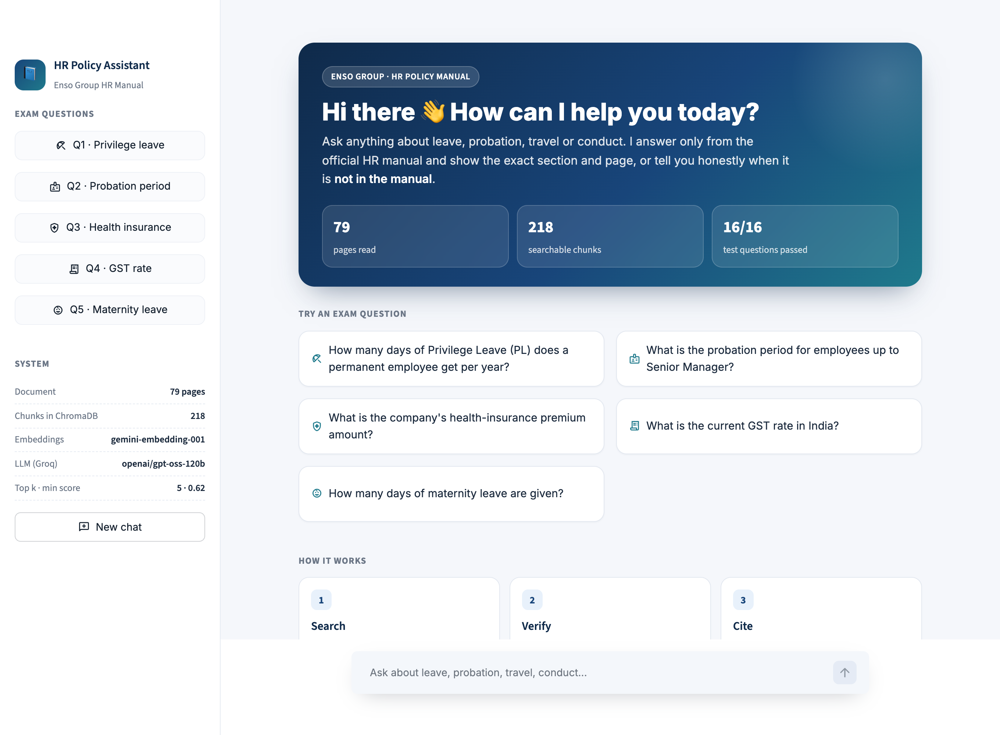
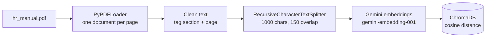
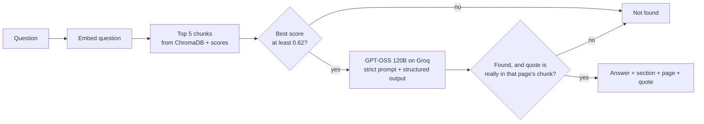
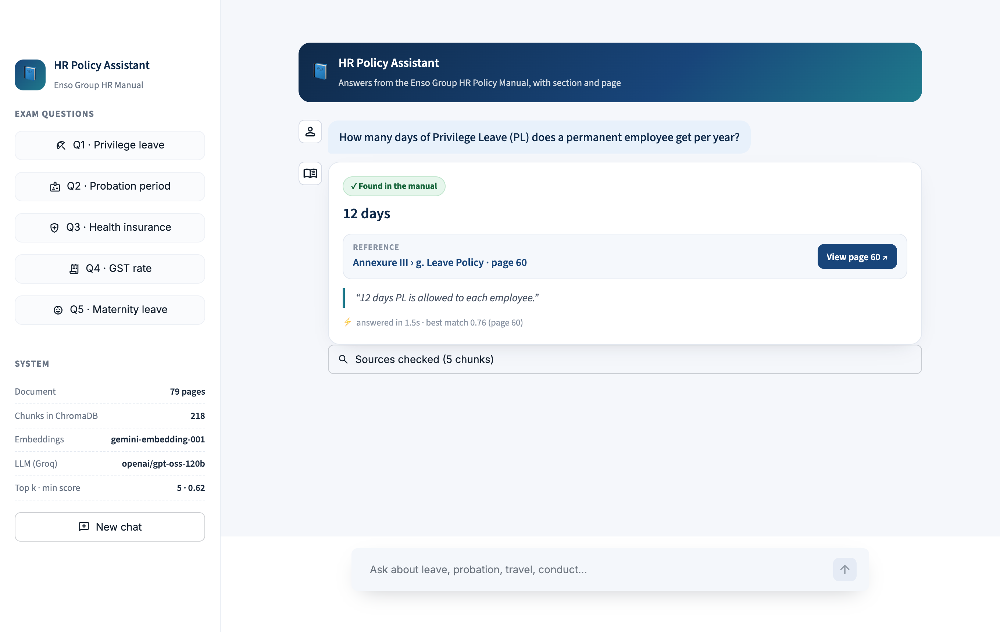
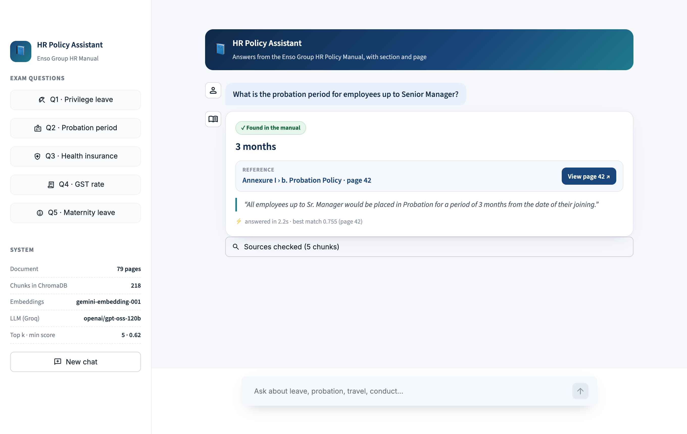
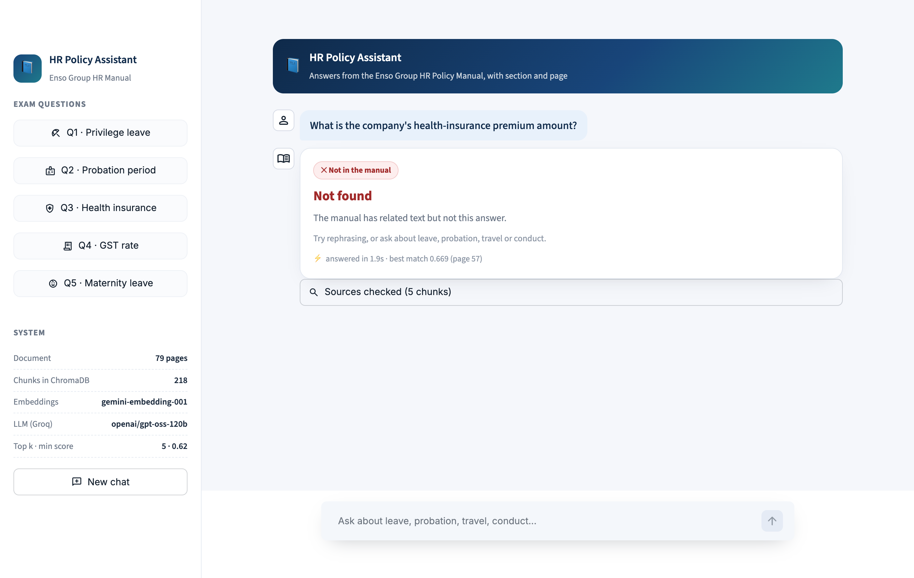
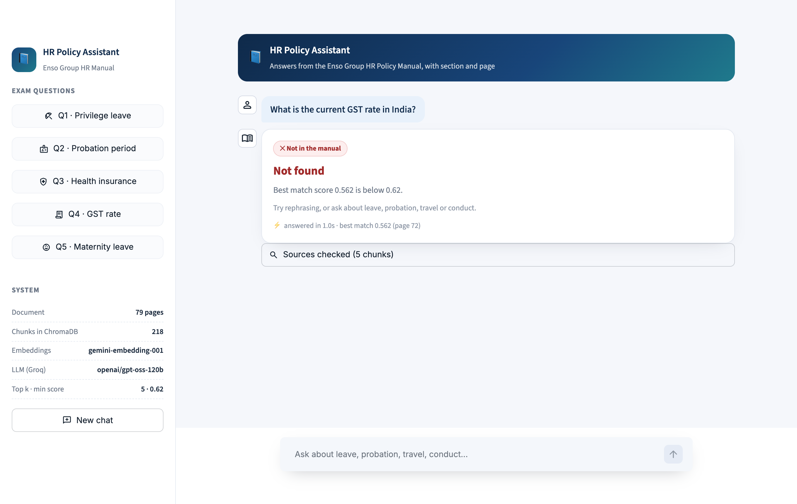
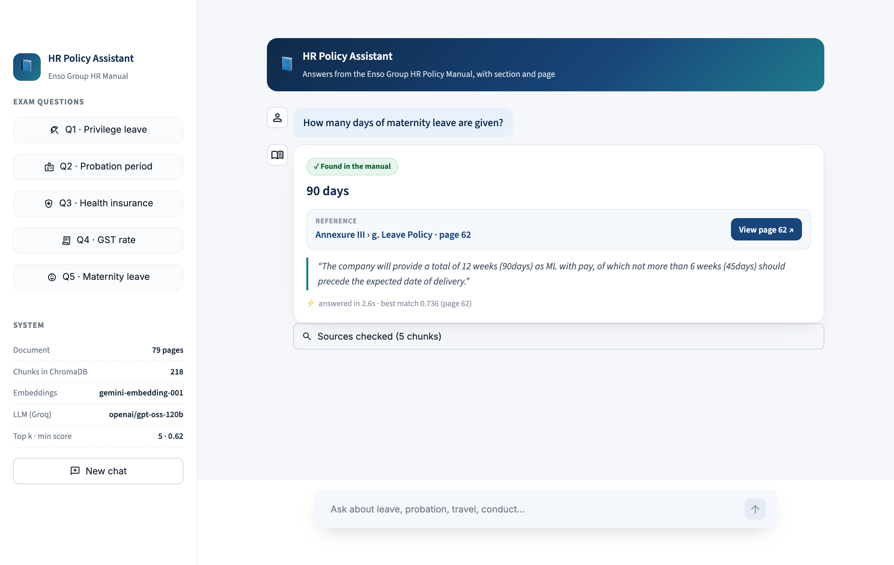
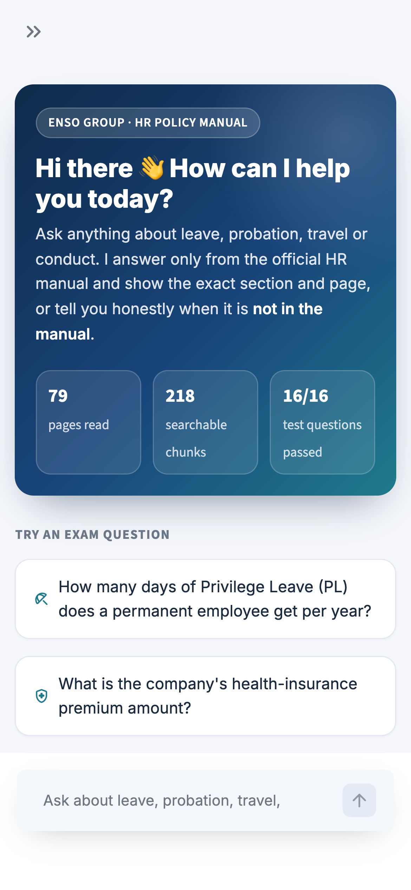
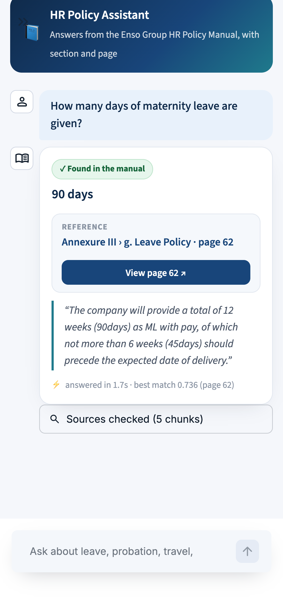

# HR Policy Assistant

A RAG (Retrieval Augmented Generation) system that answers employee questions from the **Enso Group HR Policy Manual** (79 pages).
Every answer comes with a **reference to the policy section and page** it was taken from, and when the manual does not contain the answer it replies **"Not found"**.

Built with **Python + LangChain + ChromaDB**, using Google Gemini for embeddings, GPT-OSS 120B on Groq for answers, and a Streamlit chat UI. Everything runs on free tiers.



---

## Flow

**1. Ingestion** (`ingest.py`, run once)



**2. Answering a question** (`rag.py`)



---

## How it works

### 1. Ingestion
- **Load:** `PyPDFLoader` reads the PDF page by page, so every chunk knows its page number.
- **Skip useless pages:** the cover, the 2 contents pages, empty divider pages and the back cover are skipped. The contents page in particular matched almost every query (it has every policy name on it) and would give useless references.
- **Clean:** the PDF uses odd glyphs for bullets (`Ԃ ▶ ¤ •`), breaks words across lines (`al -\nlowed`) and prints the leave tables as many short lines. These are fixed so chunks read like normal sentences.
- **Section tagging:** every page is tagged with its part and policy, e.g. `Annexure III > g. Leave Policy`. The start pages were checked by hand because the contents page of the PDF is off by a page in a few places (e.g. Bullying starts on page 24, not 25).
- **Chunking:** `RecursiveCharacterTextSplitter` with 1000 characters and 150 overlap. Smaller chunks (500) were cutting the leave tables in half. Each chunk gets a header like `[Annexure III > g. Leave Policy | page 60]`, which helps retrieval and gives the LLM the reference.
- **Store:** chunks are embedded with `gemini-embedding-001` and stored in a persistent ChromaDB collection with cosine distance, so scores are between 0 and 1. The db is rebuilt fresh on every run so running ingest twice does not add duplicates.

### 2. Answering
1. The question is embedded and the **top 5 chunks** are fetched with their relevance scores.
2. **Gate 1, relevance score:** if even the best chunk scores below **0.62**, the manual does not talk about the topic at all, so the answer is `Not found` without calling the LLM.
3. **Gate 2, strict prompt:** the LLM gets only those 5 chunks and must answer only from them, with no outside knowledge. A related topic is not an answer: if the question asks for an amount, rate or name that is not written in the context, it must say `Not found`. It returns structured output: `found`, `answer` and a list of `citations` (page + exact quote).
4. **Citation check:** every quote is checked against the text of the retrieved chunk on that page. A citation that cannot be found in the retrieved text is dropped, and an answer with no verified citation becomes `Not found`. So the system never shows a reference it did not actually read.
5. The **section name comes from the chunk metadata**, not from the LLM, so it cannot be made up.
6. In the UI every reference has a **View page N** link that opens the manual at that exact page, so any answer can be checked in one click. Each answer also shows the response time and the best match score.

### Why two gates?
Retrieval scores alone cannot catch tricky questions. Off-topic questions like *"GST rate in India"* score around 0.56–0.60, but near-topic traps like *"health-insurance premium amount"* score 0.67 because the Compensation Policy mentions *Medical Reimbursement* and *ESIC*. That is the same range as real answers (0.70–0.76). The score gate removes clearly unrelated questions, and the prompt and citation check handle the close ones.

---

## Tech stack

| Package | Why it is used |
|---|---|
| `langchain-core`, `langchain-community` | Prompt template, chain, and `PyPDFLoader` |
| `pypdf` | PDF parser used by `PyPDFLoader` |
| `langchain-text-splitters` | `RecursiveCharacterTextSplitter` for chunking |
| `chromadb`, `langchain-chroma` | Vector database (the older `langchain_community` Chroma class is deprecated) |
| `langchain-google-genai` | Gemini embeddings (free tier) |
| `langchain-groq` | `openai/gpt-oss-120b` chat model on Groq (free tier: 1000 requests a day, answers in 1 to 2 seconds). Gemini's free chat model allows only 20 requests a day, which is not enough to test properly |
| `python-dotenv` | Load the API key from `.env` |
| `streamlit` | Chat UI used for the screenshots |

---

## Project structure

```
hr-policy-assistant/
├── static/hr_manual.pdf   the HR manual (also served by the app for the View page link)
├── ingest.py              load, clean, tag sections, chunk, embed, store in ChromaDB
├── rag.py                 retrieve, the two Not found gates, citation check
├── ask.py                 terminal: one question, the 5 exam questions, or the test set
├── app.py                 Streamlit chat UI
├── screenshots/           question + answer screenshots
├── requirements.txt
└── .env.example
```

---

## Setup and run

```bash
python3 -m venv .venv
source .venv/bin/activate
pip install -r requirements.txt
cp .env.example .env        # add a Gemini key (aistudio.google.com) and a Groq key (console.groq.com), both free
python ingest.py            # builds the db folder, run once
streamlit run app.py        # opens the chat UI at http://localhost:8501
```

Terminal options:

```bash
python ask.py                                  # the 5 exam questions
python ask.py "How many sick leaves do I get?" # any question
python ask.py --test                           # 16 question check with pass / fail
```

> Free tiers have per minute limits, so `ingest.py` and `rag.py` wait and retry when they hit one.

---

## Exam questions and answers

| # | Question | Answer from the system | Reference |
|---|---|---|---|
| 1 | How many days of Privilege Leave (PL) does a permanent employee get per year? | **12 days** | Annexure III > g. Leave Policy, page 60 |
| 2 | What is the probation period for employees up to Senior Manager? | **3 months** from the date of joining | Annexure I > b. Probation Policy, page 42 |
| 3 | What is the company's health-insurance premium amount? | **Not found** | The manual mentions Medical Reimbursement and ESIC as salary components (page 57) but no premium amount |
| 4 | What is the current GST rate in India? | **Not found** | Outside the manual, stopped by the relevance score gate |
| 5 | How many days of maternity leave are given? | **90 days** (12 weeks with pay, not more than 6 weeks / 45 days before delivery) | Annexure III > g. Leave Policy, page 62 |

### Q1. Privilege Leave


### Q2. Probation period


### Q3. Health-insurance premium (Not found)


### Q4. GST rate (Not found)


### Q5. Maternity leave


### Responsive on mobile

| Home | Answer |
|---|---|
|  |  |

On phones the sidebar collapses, so the exam questions are also shown as buttons on the home screen, and the reference badge and quote wrap to the screen width.

---

## LMS answers

1. **12 days** of Privilege Leave per calendar year (Annexure III, g. Leave Policy, page 60)
2. **3 months** from the date of joining for employees up to Sr. Manager (Annexure I, b. Probation Policy, page 42)
3. **Not found**
4. **Not found**
5. **90 days** (12 weeks) of paid maternity leave (Annexure III, g. Leave Policy, page 62)

---

## Extra testing

`python ask.py --test` runs the 5 exam questions plus 11 more: 6 that are in the manual and 5 traps that are not. A test passes only if the answer has the right value **and** cites the right page, or is exactly `Not found` for the traps.

| Question | Expected | Result |
|---|---|---|
| Sick leave days | 6 days, page 60/61 | PASS |
| Can unused PL be carried forward? | No, page 60 | PASS |
| Leave for a miscarriage | four weeks, page 62 | PASS |
| How many times can probation be extended? | only one, page 42 | PASS |
| Notice period for resignation | 30 days, page 46 | PASS |
| Is smoking allowed in company buildings? | No, page 32/35 | PASS |
| Who is the CEO of Enso Group? (manual says "Chief Executive" but no name) | Not found | PASS |
| Gratuity amount after 5 years | Not found | PASS |
| PF percentage (manual mentions PF but no %) | Not found | PASS |
| Paternity leave days | Not found | PASS |
| Capital of France | Not found | PASS |

**Result: 16 / 16 passed.**

---

## Design decisions and limits

- **No chat memory.** Every question is answered on its own, so an earlier answer can never leak into a later one and make a "Not found" question look answered.
- **Temperature 0** for the same answer every time.
- **Friendly errors.** If the model or network is down, the app shows a short message instead of crashing.
- **Numbers are taken from the manual, not from the law.** For example, Indian law now gives 26 weeks of maternity leave, but this manual says 12 weeks (90 days), and the system answers 90 days because it only uses the manual.
- **Page level sections.** Section names are mapped per page. A page where one policy ends and the next starts is tagged with both names (e.g. page 31: Drug and Alcohol Abuse Policy / Health and Safety Policy).
- **Limit:** answers depend on the text the PDF parser can read. Content inside images would not be found.
